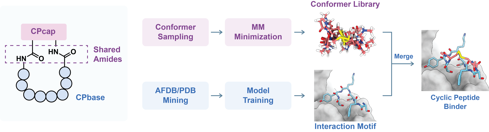

## CPSea2: Synthetic data supporting both linear and cyclic peptide design



😊 Hi there, this is  **CPSea2**, a synthetic data framework for (cyclic) peptide binder design.

🗺️ **Roadmap**
* Dataset Download: [**CPSea2 at Hugging Face**](https://huggingface.co/datasets/YZY010418/CPSea2)
* A Model Demo: [**PepAny**](https://github.com/YZY010418/PepAny)
* Previous Dataset: [**CPSea**](https://github.com/YZY010418/CPSea)

This repo provides protocols for the curation of CPbase, CPcap, and the merging between them. We also provide scripts for some evaluations on the dataset. You may visit [**Hugging Face**](https://huggingface.co/datasets/YZY010418/CPSea2) for downloading constructed datasets, and you may find our [**PepAny**](https://github.com/YZY010418/PepAny) as a model demo to explore the feasibility of constructing cyclic peptides with the merging protocol. 

**CPSea2** is named after our previous synthetic dataset for cyclic peptide binder design named [**CPSea**](https://github.com/YZY010418/CPSea). 

💎 **What's inherited**:

* The idea of mimicking inter-chain interactions by intra-chain interfaces.
* Overall pipeline of screening plausible binder-receptor pairs.

💪 **What's new**:

* Expanding the scope of peptide binders to linear peptides.
* Re-designing filters to make synthetic data align better to experimental references.
* Constructing cyclic peptides by merging linear peptides and capping structures.

---

## 🔍 Get CPbase

Because we didn't perform minimization on CPbase, we provide the `ResID maps` and `Metadata files` that describes the residue ID of the ligand and receptor chains in AFDB as well as some basic properties of these complexes. We recommend to reconstruct complex structures after downloading the AFDB50 source data, because directly upload/download structure files would cost TB level transition, and actually the new information here is only the residue ID of ligand and receptor chains. The AFDB50 dataset and the CPbase ResID map can be downloaded by

```bash
# Install huggingface tool
pip install -U huggingface_hub

# Download metadata and ResID maps
hf download YZY010418/CPSea2 \
  --repo-type dataset \
  --revision main \
  --include "CPbase_AFDB/Metadata/*" "CPbase_AFDB/ResID_Map/*" \
  --local-dir ./CPSea2

# Download source data
wget https://steineggerlab.s3.amazonaws.com/foldseek/afdb50.tar.gz
tar -xvzf afdb50.tar.gz
```

Use [`scripts/rebuild_cpbase.py`](scripts/rebuild_cpbase.py) to select a **CPbase_AFDB subset** from metadata and reconstruct its complexes from full AFDB50 source PDBs. It requires Python 3.10+ and only the standard library. It crops existing coordinates using ResID maps; it does not rerun structure mining or energy minimization, and does not reconstruct CPbase_PDB.

Run the following commands from this repository's root. Set the metadata, ResID map, and extracted AFDB50 paths to your local directories (the examples use `./CPSea2/CPbase_AFDB/{Metadata,ResID_Map}` and `./afdb50`). Metadata and ResID inputs must be separate TSV or TSV.gz files/directories; directory scanning is recursive.

```bash
# Copy the selection template and edit its rules for your use case.
cp scripts/rebuild_cpbase_template.json cpbase_selection.json

# Preview selection and check metadata/ResID joins and source file paths.
python3 scripts/rebuild_cpbase.py \
  --metadata ./CPSea2/CPbase_AFDB/Metadata \
  --resid ./CPSea2/CPbase_AFDB/ResID_Map \
  --source-dir ./afdb50 \
  --config cpbase_selection.json \
  --output ./CPbase_subset_preview \
  --dry-run

# After inspecting selected.tsv and summary.json, reconstruct into a NEW directory.
python3 scripts/rebuild_cpbase.py \
  --metadata ./CPSea2/CPbase_AFDB/Metadata \
  --resid ./CPSea2/CPbase_AFDB/ResID_Map \
  --source-dir ./afdb50 \
  --config cpbase_selection.json \
  --output ./CPbase_subset \
  --gzip
```

`--dry-run` does not read source coordinates or validate their atoms. Each output directory must not already exist. `--gzip` writes compressed PDBs; omit it for plain PDBs.

**Choosing the subset.** Edit the ordered `rules` list in `cpbase_selection.json`. The supplied template first keeps `Length` 5–12, `relBSA >= 0.35`, `SheetRatio <= 0.5`, and both `rel_n_rBSA` and `rel_c_rBSA >= 0.4`. It then keeps complexes with `relBSA` at least 90% of the surviving cluster maximum, and finally selects one complex with the largest `relBSA` per cluster. These thresholds are examples, not mandatory dataset filters.

| Rule | Purpose | Example |
| --- | --- | --- |
| `range` | Filter individual complexes by a numeric metric | `{"op":"range","field":"Length","min":5,"max":12}` |
| `top` | Keep the best N complexes (or a fraction) within each cluster | `{"op":"top","field":"relBSA","n":3,"order":"desc"}` |
| `relative` | Compare each complex to a statistic of its current cluster | `{"op":"relative","field":"relBSA","stat":"max","mode":"ratio","min":0.9}` |
| `aggregate` | Keep whole clusters based on their current members | `{"op":"aggregate","stat":"count","min":3}` |

Rules execute in list order, and every rule sees only the survivors of previous rules. A cluster is `(Source_ID, Domain_ID, Cluster_ID)`, not a receptor sequence cluster. For example, put a cluster-size filter **before** `top` if you want to count members before selecting representatives. `min`/`max` include the boundary; `gt`/`lt` exclude it. Remove the `top` rule to keep all complexes passing the preceding filters, or use `{"rules": []}` to select all metadata rows. With the template's final top-1 rule, the preceding 90%-of-maximum rule does not change the final winner.

**Inputs and results.** ResID maps must contain `Source_ID`, `Domain_ID`, `Cluster_ID`, `Ligand_ID`, `receptor_res_ids`, and `ligand_res_ids`. Historical invalid IDs such as `NA` must be repaired before reconstruction. Source structures must retain the original residue numbering; use full `.pdb`/`.pdb.gz` files, not domain-cropped PDBs or tar archives. For nonstandard filenames, use `--source-manifest` as described in the [full reconstruction guide](scripts/README_rebuild_cpbase.md).

Successful structures appear under `structures/<shard>/`, with receptor chain `R`, ligand chain `L`, and ACE/NME caps reconstructed from the recorded precursor residues. `selected.tsv` records selected complexes and paths; `summary.json` records counts after each rule and reconstruction totals; `errors.tsv` records failed complexes. A reconstruction run with failures exits with status 1, so selection alone does not imply successful reconstruction. The output also preserves `config.json` and an audit database, `selection.sqlite`.


AFDB-multimer has been released recently, but it is not included in the current version of CPSea2 because we have not yet found a separately downloadable package. Nevertheless, we expect that these data can be processed using a script similar to the PDB pipeline, with an additional pLDDT-based confidence filter. We plan to explore the inclusion of AFDB-multimer data in future work.

## 🎲 Sample CPcap

The CPbase datasets provide interaction interfaces and terminal amide geometries. Now we generate plausible conformations for capping structures. To automatically get a proper number of conformation generation, we sample conformations in batch and check the number of clusters increased after a new batch of conformations is generated. When the increase number declines to a certain extent, we suppose that the plausible conformations have been adequately explored, and stop conformation sampling.

You may run this protocol for conformation sampling:

```bash
python CappingConformerAuto.py --name name_of_the_capping --smiles 'smiles' --out out_path -p num_processors_used_in_minimization_and_clustering --schrodinger-run path_for_schrodinger/run
```

Useful arguments include:

* `--batch-size` controls the number of conformers generated per batch, for example `--batch-size 2000`.
* `--max-batches` sets the maximum number of batches to sample, for example `--max-batches 80`.
* `--seed-start` sets the random seed for the first batch; later batches use incremented seeds, for example `--seed-start 123`.
* `--cluster-rmsd` sets the RMSD cutoff used for Butina clustering, for example `--cluster-rmsd 0.5`.
* `--min-cluster-increase` and `--patience` define when cluster growth has saturated enough to stop, for example `--min-cluster-increase 5 --patience 3`.
* `--energy-keep-percent` keeps only the lowest-energy relaxed conformers by percentile, for example `--energy-keep-percent 90`; set it to `100` to disable this energy filter.
* `--python` sets the Python executable used to run `CappingGen.py`, for example `--python python3` or `--python /path/to/python`.
* `--cluster-processors` sets the number of processes used for RMSD clustering, for example `--cluster-processors 8`; by default, it follows `--processors`.
* `--keep-batches` retains intermediate batch files for debugging or inspection; it is a switch and does not take a value.
* `--ligand-asl` sets the Schrodinger ASL expression used to identify the ligand during relaxation, for example `--ligand-asl 'chain.name "A"'`.
* `--hydrogen-scope` controls whether all hydrogens or only ligand hydrogens are adjusted during relaxation; options are `all` and `ligand`.
* `--max-steps` sets the maximum number of minimization steps in Schrodinger relaxation, for example `--max-steps 300`.
* `--grad-conv` sets the gradient convergence threshold for stopping minimization, for example `--grad-conv 0.05`.
* `--dielectric` sets the dielectric constant used during relaxation, for example `--dielectric 80`.

## 🔗 Merge CPcap and CPbase
Now we can construct cyclic peptide binders by searching CPbase-CPcap pairs whose terminal amides align to each other.

Because CPcap conformers are saved as .sdf files, we need to define which cap atoms correspond to the two terminal amide geometries used for alignment. Add these atom names to `CappingIndex.yaml`. Note that the atom-name CSV generated during CPcap sampling can help you and the scripts to map the atom names to atom indexes.

```yaml
Thioether-A: # Cap name used by --cap-name
  mode_1: # Multiple modes can be listed if one cap has several possible terminal-amide definitions.
    C_ter: "C2, N1, C1, O1, C3" # NME CA, N -> last-residue C, O, CA
    N_ter: "C7, C6, O2, N2, C5" # ACE CA, C, O -> first-residue N, CA
```

Then align CPcap conformers to CPbase terminal geometries and save the accepted capped complexes:

```bash
python Merge/CappingAlignBatch.py --base path_to_CPbase_cif_dir --cap path_to_CPcapping_sdf_dir --index CappingIndex.yaml --cap-name Thioether-A -o output_path -p num_processors
```

Useful arguments include:

* `--rmsd-cutoff` sets the maximum anchor RMSD accepted after alignment, for example `--rmsd-cutoff 0.5`.
* `--distance-cutoff` filters candidates by the 9D terminal descriptor distance before RMSD alignment, for example `--distance-cutoff 3.0`.
* `--clash-threshold` controls the VDW-scaled clash rejection threshold, for example `--clash-threshold 0.8`.
* `--cyclic-type-name` changes the output file prefix when you want it to differ from `--cap-name`.
* `--save-all` keeps all clash-free hits in the retrieved candidate set instead of only the default accepted outputs.

The merge step writes capped PDB complexes, a metadata CSV containing descriptor distances and anchor RMSD values for saved structures, and a summary CSV for monitoring progress.

Finally, relax the merged complexes with Schrodinger to remove local geometric irregularities:

```bash
$SCHRODINGER/run python3 SampleCPCap/relax_light.py -i merged_pdb_dir -o relaxed_pdb_dir -p num_processors
```

The relaxed output directory contains the final cyclic peptide binder complexes.


## 📈 Evaluations

We evaluate complex structures using tools including BSA, PLIP, GRAVY, Vina and FoldX. The SASA, PLIP, Vina, and FoldX scripts use `--input-type` to select the expected input layout, such as `pdb`, `cpsea2`, `cpsea2afdb`, `pepbench`, or `pdb-chain`. We also evaluate redundancy by clustering complexes based on receptor sequences using MMSeqs2. These analysis scripts can found in the `Evaluations` directory.
